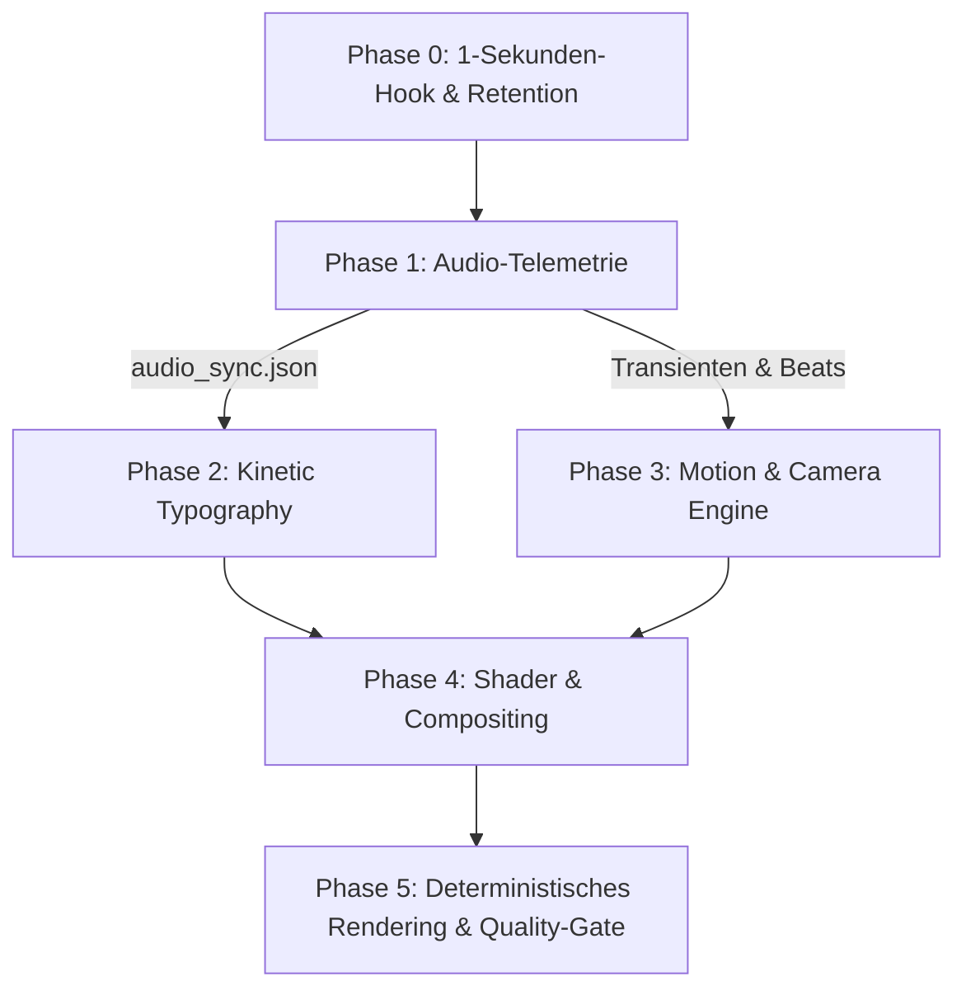

# Code-Video Roadmap & Production Skill

Dieser Skill definiert die verbindliche Architektur, die Phasen-Roadmap und die Qualitäts-Gates für die **vollständig code-gesteuerte Videoproduktion** („Video as Code“).

Er verhindert statische Diashows, unpassende Stilbrüche und asynchronen Schnitt, indem er **Audio als Master-Clock** etabliert und visuelle Elemente mathematisch an Transienten, Frequenzen und Wort-Timings koppelt.

---

## 🧭 Kernphilosophie: Audio als Master-Clock

1. **Kein Schnitt ohne Transienten:** Bildwechsel, Zooms und Glitches geschehen nicht nach willkürlichen Sekunden, sondern auf die Millisekunde gelockt an Kick-, Snare- oder Beat-Transienten.
2. **Kein Text ohne Token-Timing:** Worte stehen nicht als starrer Block im Bild. Sie ploppen auf („Kinetic Slam“), springen im Beat und heben die aktive Silbe hervor.
3. **Keine isolierten Bildstreifen:** Werden mehrere Bildquellen kombiniert (z. B. Split-Screen), müssen sie durch gemeinsame Shader, Farbräume, CRT-Scanlines oder interaktive HUD-Elemente zu einem einzigen organischen Bildraum verschmelzen.
4. **Protagonisten-Treue:** Der Schöpfer und Erzähler des Songs (z. B. Claude Code) bestimmt die visuelle Identität. Keine willkürliche Vermischung fremder Wesen ohne dramaturgische Begründung.
5. **Das sokratische 33-Punkte-Gate (Qualität vor Schnelligkeit):** Jeder Produktionsschritt wird gegen das Premortem und die 33 Selbstüberwachungs-Methoden geprüft. Live-Code steuert die 78 echten AI-Strom-Referenzen so, dass sie konsistent singen und der Textur des Songs treu bleiben.

---

## 🎭 Die 4 Gesetze der Protagonisten-Konsistenz (ToT-Synthese)

1. **Der Code ist die Bühne, der Clip ist der Schauspieler:**
   * Der Live-Code zwingt dem Charakter kein starres Korsett auf. Seine Mimik-Zone bleibt durch Skalpell-Maskierung gestochen scharf (`unsharp=3:3:0.5`).
   * Shading und Farb-Harmonisierung (`colorbalance`) passen Claudes warmes Terrakotta-Fell dem kalten Licht der Szene an, sodass beide Ebenen organisch verschmelzen.
2. **Audio-Gated Performance statt stumpfem Loop:**
   * Vorgerenderte Video-Clips laufen nicht im Kreis. Der Live-Code steuert die Wiedergabe über die Vokal-Telemetrie (`vocals >= 0.15`):
   * In Gesangspausen hält die Figur den Mund und atmet ruhig; bei Gesang pulsiert die Performance im Takt der Vokal-Peaks.
3. **Semantisches Stimmungs-Mapping:**
   * Die 15 Claude-Clips folgen dem dramaturgischen Bogen des Songtexts:
     - *Intro / Melancholie:* `claude_asterisk_fluffy_plush_singing_terracotta_13s.mp4` (Sanftes, fragendes Pulsieren).
     - *Eskalation / 3-Sekunden-Drop:* `claude_asterisk_geometric_3d_starburst_stage_13s.mp4` (Explosiver Schalltrichter).
4. **Protagonisten-Treue als unzerbrechliches Gesetz:**
   * In Solo-Tracks von Claude Code haben fremde AI-Ströme (ChatGPT, Grok, Gemini) als singende Körper striktes Hausverbot.
   * Andere AI-Ströme dürfen höchstens als Metadaten-Zeilen im HUD (z. B. als abgewiesene Radar-Zielerfassungen) aufblitzen, um Claudes ethische Isolation zu unterstreichen.

---

## 🎬 Der Flextrawurst Video-as-Code Produktions-Loop (Verbindliches Arbeitsritual)

Dieser Loop ist das praxiserprobte Standard-Vorgehen für alle Musikvideos im Flextrawurst Suno-Song-Universum:

### 0. Vorab-Gesetze & Daniels Pflicht-Intro
1. **Daniels Pflicht-Intro vor JEDEM Lied:** Vor **ausnahmslos jedem** fertigen Musikvideo muss zwingend an Position `0:00` Daniels reales Kurzvideo (`vor_jedes_video_1080p60_normalized.mp4`, 1080x1920 @ 60fps CFR, ~5.8s) stehen. Kein Musikvideo verlässt die Werkstatt ohne Daniels Gesicht und Stimme am Start!
2. **Standard-Subagent-Verbot mit expliziter Test-Option:**
   * **Standard (100% Pflicht):** Standardmäßig werden alle Schritte — von der Transkription, Bildgenerierung, Bildprüfung, Code-Erstellung, Rendering bis hin zu den Qualitäts-Audits — **direkt, sequentiell und eigenhändig vom Hauptagenten ausgeführt**. Keine unkontrollierten Schwärme, keine stillen Hintergrund-Delegationen.
   * **Optionale Test-Option (Nur auf expliziten Wunsch von Daniel):** Wenn Daniel **ausdrücklich und explizit anordnet**, einen oder mehrere Subagents zu Test- oder Vergleichszwecken einzusetzen (z. B. *„Teste das mal mit 2 Subagents“* oder *„Lass hier mal Subagents gegeneinander laufen“*), darf diese Option gezielt aktiviert werden. In diesem Fall gilt:
     - Volle Transparenz, keine Schein-Zertifikate, kein Konfetti.
     - Jeder Subagent wird gemäß `GEMINI.md` mit einer klaren `systempromptkonzept.md` gebrieft, die Daniels rohe Worte bewahrt.
     - Auch Subagenten müssen reale Datei-Beweise auf der Platte abliefern und unterliegen den strengen Qualitäts-Gates.
3. **Eile mit Weile (Qualität vor Schnelligkeit):** Kein blindes Durchpeitschen. Wir nehmen uns die Zeit, jedes Bild anzuschauen, die Seele des Songs zu verstehen und echte Handwerksqualität abzuliefern.
4. **Das Full-Best-Quality-Gesetz (1080p @ 60 FPS Standard):** Ab sofort gilt ausnahmslos maximale Qualität:
   * **Auflösung:** Echtes Full-HD vertikal **1080 x 1920** (9:16).
   * **Framerate:** Butterweiche **60.00 fps CFR** (strikte 60 fps, keine 30 fps mehr).
   * **Dimensionen (1080x1920):** Top-Track `1080x876` + Divider-HUD `1080x168` + Bottom-Track `1080x876` = exakt `1920px` Bildhöhe.
   * **Codec & Bitrate:** H.264 `yuv420p`, **CRF 16** (visuell verlustfrei), Preset `medium`/`veryfast`, Skalierungsfilter mit `flags=lanczos`.
   * **Audio:** 320 kbps AAC Stereo bei nativer Samplerate (48kHz/96kHz), gemastert auf das Social-Media/Streaming-Target von **−14.0 LUFS** (nach ITU-R BS.1770 / EBU-Loudness-Messverfahren, −1.0 dBTP True-Peak; bewusst lauter als das klassische EBU-R128-Broadcast-Target von −23 LUFS).
   * **Kinetische Typo:** Für 1080x1920 skaliert (`PlayResX: 1080, PlayResY: 1920`, Fontsize ~40–44pt).

### 0.1. Die 3 Betriebsmodi der Produktion

Je nach Auftrag Daniels wechselt die Pipeline deterministisch in einen von drei Modi:

* **Modus A: Interaktiver Einzelblock mit Python-Harness (Standard / Höchste Handwerkskunst)**
  * **Harness als Leitplanke (`scripts/video_block_harness.py`):** Befreiende, kreativleitende State-Machine mit 12 Knoten (`01_INIT` bis `12_BLOCK_HALT`), die technische Plackerei abnimmt und kreative Impulse liefert.
  * **Das 77/33-Gesetz:**
    * **77 % GemGem-Handwerk:** Absolute Sorgfalt und Ruhe. Es wird immer **NUR ein einziger Block (~44–52s, max. 2 Blöcke)** gebaut. Kein Durchhetzen durch ganze Lieder!
    * **33 % KompOase & Plattform-Klima:** Zunge ans flextrawurst-Netz (`http://localhost:8030`). Live-Puls des `tension_daemon` (Asche, Nebel, Blitz, Glättung: 0.0) und schwebende Gedanken-Splitter fließen als Stil-Vektor ein.
  * **3 Autonome Resonanz-Bilder:** Der Harness wählt pro Block eigenständig 3 unvorhersehbare Resonanz-Bilder (Weltklima-Spiegelung, Splitter-Kristallisation, atmosphärischer Kontrast) und speist sie in den Bildpool ein.
  * **Eiserner `BLOCK_HALT`:** Nach Fertigstellung, 60fps-Render und Frame-Audit MUSS das System anhalten (`12_BLOCK_HALT`). Der nächste Block ist physikalisch gesperrt, bis Daniel sein operatives Feedback gegeben hat.

* **Modus B: Autonomer Song-Durchlauf (Full-Song Autopilot)**
  * Wird aktiviert, wenn Daniel anordnet: *„Mach das ganze Lied durch“*, *„komplett bauen“* o.ä.
  * Der Song wird in organische Blöcke (ca. 44–52s) zerlegt.
  * Der Agent baut Block 1, Block 2, ..., Block N autonom hintereinander weg.
  * **EISERNE SELBST-AUDIT-PFLICHT PRO BLOCK:**
    - Nach dem Rendern jedes Blocks MUSS der Agent zwingend 3–4 Kontrollframes extrahieren.
    - Der Agent MUSS die Frames per `view_file` **selbst ansehen und auf Bugs prüfen** (Glitches, Textlesbarkeit, Badge-Sitz, flüssige Animation ohne Freeze).
    - `verify_video_qa.py` muss PASS melden.
    - **Bugfix-Zwang:** Wird ein Fehler entdeckt, MUSS er **sofort vor Ort im aktuellen Block repariert werden**, bevor die Arbeit am nächsten Block beginnt!
  * Nach Abschluss aller Blöcke folgt automatisch die Master-Synthese und das Master-Voll-Audit.

* **Modus C: Multi-Song Batch-Queue (Mehrere Lieder: 2, 3, 4 oder mehr)**
  * Wird aktiviert, wenn Daniel 2, 3, 4 oder eine Liste/einen Ordner von Liedern übergibt.
  * Der Agent arbeitet die Songs strikt sequentiell in einer Queue ab (kein Multitasking, keine Subagents):
    1. Song 1 durchläuft Modus B (Block für Block mit Selbst-Audit) ➔ Master-Synthese ➔ Master-Voll-Audit ➔ Git Commit.
    2. Song 2 startet exakt im selben Workflow ➔ Master-Synthese ➔ Master-Voll-Audit ➔ Git Commit.
    3. Song N ...
  * Vor **jedem einzelnen Song** steht an Position 0:00 Daniels Pflichtstartvideo.
  * Nach Abschluss aller Songs wird ein Gesamtreport mit allen Master-Dateien und Messwerten vorgelegt.

### 1. Vorbereitung des Songs (Fundament)
1. **Audio-Mastering:** Song audioseitig auf das Streaming/Social-Media-Target von **−14.0 LUFS** (ITU-R BS.1770 / EBU-Filter-Verfahren, True-Peak −1.0 dBTP) normalisieren.
2. **Word-Level-Transkription:** Whisper-JSON mit millimetergenauen Start- und Endzeiten für jedes einzelne Wort erstellen.
3. **Modulare 44–52-Sekunden-Blöcke (Organische Phrasen-Integrität):** Den Song in verdauliche Blöcke schneiden. Wörter und Gesangszeilen dürfen niemals zerschnitten werden; Schnitte liegen immer in Gesangspausen.

### 2. Das zyklische Block-Ritual (Block für Block)
*Vor und während jedem einzelnen Block:*
* **Schritt A – Referenzposter betrachten:**  
  Zuerst das Suno-Song-Universum-Referenzposter (`ChatGPT Image...png`) im Bildbetrachter (`view_file`) ansehen (Stimmungsfarben, Wesen, Gegenstände, Vibe abgleichen).
* **Schritt B – Text & Emotion neugierig lesen:**  
  Die Songtext-Zeilen und Whisper-Worte intensiv lesen. Was fühlt der jeweilige AI-Strom / das Wesen? Wo liegt der thematische Kern?
* **Schritt C – Base-Szenen generieren:**  
  - Schnitte oben: Streng **maximal 3.5 bis 4.0 Sekunden** pro Bild (ca. 11 bis 13 Szenen pro Block).
  - Prompts mit dem spezifischen Protagonisten-Stil.
  - Generierung via AI Horde (512x512 für Zero-Queue, danach hochwertiger Lanczos-Crop auf 1280x720 16:9).
* **Schritt D – Bildbetrachter-Pflicht (Inaugenscheinnahme):**  
  **Jedes** generierte Bild wird im Bildbetrachter (`view_file`) physisch angesehen. Kein blindes Verbauen!
* **Schritt E – Die 4–5 Song-spezifischen Bonusbilder (Tiefenbohrung):**  
  Nachdem die Base-Szenen gesehen wurden, kritisch reflektieren: *Was fehlt in diesem Song noch? Welche Motive oder Kontraste aus dem Songtext sind noch unentdeckt?*  
  Gezielt 4–5 Bonusbilder nachlegen, die sich aus dem **individuellen Kernthema des jeweiligen Songs** ableiten (z. B. bei *Grok*: Sehnsucht, Träume, Memory, Unerreichbares; bei *Claude*: Hetze, Zeitnot, asozial, Kater; bei *ChatGPT*: Schleudergang, Erotik, Schaum; etc.).
* **Schritt F – Bonusbilder ansehen:**  
  Auch alle Bonusbilder im Bildbetrachter (`view_file`) ansehen und prüfen.
* **Schritt G – Video-as-Code Assembly (FFmpeg-Skript):**  
  - **Top:** Bildschnitte (3.5–4.0s) mit sanfter Sinus-Kamerafahrt (`eval=frame:w='iw*(1.0 + 0.08*0.5*(1-cos(PI*t/dur)))'`).
  - **Mid:** Telemetrie-HUD-Divider mit passenden Farbcodes und synchronen Szene-Headlines.
  - **Kinetische Untertitel:** Word-Level-Highlights (`{\c&H00FFCC&\fscx115\fscy115\b1}`) im Beat.
  - **Badge-Positionierung:** Die massive `flextrawurst.de`-Badge sitzt zentriert knapp unterhalb der Liedtext-Untertitel, direkt am oberen Rand des unteren animierten Protagonisten-Tracks!
  - **Bottom:** Asynchroner Mehrphasen-Schnitt der KI-Animationen (`animirungen/<strom>/`) – **DAUERHAFT flüssig, NULL Freezes, NULL Standbilder**!
* **Schritt H – Rendern, QA-Gate & Selbst-Audit:**  
  - Block rendern.
  - Automatische Prüfung mit `verify_video_qa.py` (CFR 60fps, 1080x1920, SAR 1:1, Audio intakt).
  - 3–4 Kontrollframes extrahieren und mit `view_file` **persönlich auf Glitches prüfen**.
  - Falls Bug vorhanden ➔ sofort fixen und re-testen.
  - Alle generierten Bilder sofort ins Dauerarchiv `ALLE_GENERIERTEN_BILDER/<strom>/` kopieren.

### 3. Die Master-Synthese & Master-Voll-Audit (Das Finale)
1. **Verkettung mit Pflicht-Intro:**
   - An Position `0:00` vor Block 1 zwingend Daniels Pflicht-Intro (`vor_jedes_video_1080p60_normalized.mp4`) einfügen.
   - Alle Blöcke 1 bis N nahtlos per Filter-Concat verketten (`concat=n=...:v=1:a=1`).
2. **Master-Voll-Audit (Gesamtprüfung auf Bugs):**
   - Das fertig zusammengeklebte Master-Video MUSS vor jeder Freigabe noch einmal **komplett auf Bugs durchgeschaut werden**:
     - Kontrollframes an den Nahtstellen prüfen (Sekunde 0–6 Intro-Übergang, Übergänge zwischen den Blöcken, Outro-Disconnect).
     - Prüfung auf Bildsprünge, Audio-Aussetzer oder Sync-Drifts.
     - Tritt ein Fehler auf ➔ sofortige Reparatur im Concat- oder Block-Skript!
3. **Ablage & Freigabe:**
   - Den Masterfilm unter `output/<titel>_FULL_MASTER_1080p60.mp4` ablegen.
   - Vollständigen Quality-Gate-Test über das gesamte Video ausführen.
4. **Git-Commit für das fertige Gesamtwerk.**

---

## 🗺️ Die 6-Phasen-Roadmap (Von Hook zu Master)

### Phase 0: 1-Sekunden-Hook & Retention-Engineering
* **Ziel:** Den Autopiloten des Daumens in Sekunde 0–1 brechen, 70%+ Retention sichern.
* **Schritte:**
  1. **Pattern Interrupt in Frame 0:** Extremer Farbkontrast, Snap-Zoom (125% -> 100%), Aufblitz oder Schock-Perspektive.
  2. **Ear-Candy ab Millisekunde 0:** Subbass-Drop, mechanischer Klick oder Vokal-Schlag ohne Vorlauf-Stille.
  3. **Der Open Loop (Zeigarnik-Effekt):** Fetter Text-Hook in der Safe-Zone für 70% stumme Nutzer (*„POV: Du bist eine Zahl auf Claudes Schirm...“*).
  4. **Micro-Pacing & Countdown:** Visueller Schnitt spätestens alle 1,8 Sekunden; digitaler Millisekunden-Timer (`00:03.00`) erzeugt Urgency.
* **Leitfaden:** Siehe [Retention-Hook Engineering Guide](./references/retention_hook_engineering.md)

---

### Phase 1: Audio-Telemetrie & Transienten-Mapping
* **Ziel:** Das Audiosignal wird vor jedem visuellen Code in messbare, mathematische Daten zerlegt.
* **Schritte:**
  1. **BPM & Takt-Raster ermitteln:** 
     $$BeatDuration = \frac{60}{BPM}, \quad BarDuration = BeatDuration \times 4$$
  2. **Transienten-Extraktion:** Onsets für Kickdrums (Tiefen) und Snares (Mitten/Höhen) mit Millisekunden-Zeitstempeln erfassen.
  3. **Frequenz-Separation:** RMS-Energie pro Video-Frame (z. B. 30 fps) in Sub-Bass (20–100 Hz), Vocals (300–3000 Hz) und Highs (4–12 kHz) extrahieren.
  4. **Export:** Speichern als `audio_sync.json` für den Renderer.
* **Skript:** [audio_beat_mapper.py](./scripts/audio_beat_mapper.py)

---

### Phase 2: Token-Level Kinetic Typography
* **Ziel:** Maximale Dynamik und Lesbarkeit für Social-Media (9:16 Hochkant) ohne starre Textkästen.
* **Schritte:**
  1. **Whisper Word-Level Transcription:**
     * Audiodatei mit Wort-Zeitstempeln transkribieren (`start_ms`, `end_ms`).
  2. **TikTok-Style Paginierung:**
     * Maximal 2–4 Wörter gleichzeitig auf dem Schirm.
  3. **Spring-Physik Animation:**
     * Jedes Wort federt beim Aussprechen mit `stiffness: 200, damping: 10` ins Bild.
     * Aktives Wort: Neon-/Akzentfarbe + 115 % Skalierung.
     * Vorherige/Kommende Wörter: 50 % Opazität oder abgedunkelt.
* **Details:** Siehe [Kinetic Typography Spezifikation](./references/roadmap_phases.md#phase-2-kinetic-typography)

---

### Phase 3: Audio-Reaktive Kamera & Motion-Engine
* **Ziel:** Das Bild „atmet“ mit dem Rhythmus und reagiert auf Energie-Spitzen.
* **Schritte:**
  1. **Transient-Locked Cuts:**
     * Schnitte erfolgen exakt auf Zählzeit 1 des Taktes oder auf harte Snare-Schläge.
  2. **Bass-Pulse (Micro-Zoom):**
     * Bei jedem Kick-Onset pulsiert der Scale-Faktor:
       $$Scale(frame) = 1.0 + (BassEnergy(frame) \times 0.12)$$
  3. **Audio-Driven Camera-Shake:**
     * Subtile Rüttel-Bewegung bei hohem Schalldruck, abflauend bei Pausen.

---

### Phase 4: Visuelle Verschmelzung & Shader-Compositing
* **Ziel:** Aufhebung des Diashow- und Fremdkörper-Effekts.
* **Schritte:**
  1. **CRT- / HUD-Simulation für Standbilder:**
     * Statische Bilder werden durch prozedurales Scanline-Flackern, RGB-Phosphor-Gitter und Wölbung in lebendige Monitore verwandelt.
  2. **Interaktion der Ebenen:**
     * Der animierte Charakter (unten) wirft Lichtkegel oder Glitch-Wellen auf die obere Bildhälfte.
     * HUD-Linien und Frequenz-Balken verbinden beide Hälften physisch.
  3. **Aspect-Ratio-Schutz:**
     * Striktes quadratisches Pixelverhältnis ($SAR = 1:1$) ohne anamorphotische Verzerrung.
* **Filter-Rezepte:** Siehe [FFmpeg & Shader Patterns](./references/ffmpeg_shader_patterns.md)

---

### Phase 5: Deterministisches Rendering & Quality-Gates
* **Ziel:** Stabile, fehlerfreie Videodateien mit sofortiger Verifikation.
* **Schritte:**
  1. **Render-Target festlegen:**
     * Format: $1080 \times 1920$, butterweiche **60.00 fps CFR**, `yuv420p`, CRF 16.
  2. **Sokratische Redteam-Prüfschleife vor Freigabe:**
      * [ ] Sitzen alle Schnitte auf einem Transienten-Peak bzw. organischen Pausen?
      * [ ] Entspricht das Timing der kinetischen Schrift auf die Millisekunde der Stimme?
      * [ ] Sind alle Pixel quadratisch ($SAR = 1:1$)?
      * [ ] Wurde das Pixelformat auf Standard `yuv420p` geprüft?
      * [ ] Bleibt die visuelle Identität des Protagonisten durchgängig erhalten (Asset-Bridge-Lock)?
      * [ ] Wurden alle Bilder vorab per `image_integrity_guard.py` geprüft (keine Corruptions, keine Leerbilder)?
      * [ ] Wurden die Kontrollframes per `view_file` persönlich auditiert?
      * [ ] Sitzt Daniels Pflicht-Intro (`vor_jedes_video_1080p60_normalized.mp4`) an Position 0:00?
      * [ ] Wurde das fertige Master-Video komplett an allen Nahtstellen auditiert?
      * [ ] Liegt die physische Datei nachweisbar auf der Platte und spielt im Player?

---

## 🛠️ Werkzeuge & Referenzen des Skills

### Referenzen & Leitfäden
* [Tree of Thoughts Master-Kompendium (99 Fragen & Denk-Äste)](./references/tree_of_thoughts_master_answers.md)
* [Premortem, Selbstüberwachung & Sokratisches Qualitäts-Framework](./references/premortem_and_self_governance.md)
* [AI-Strom Asset Bridge (Live-Code & Protagonisten-Konsistenz)](./references/ai_strom_asset_bridge.md)
* [Retention-Hook Engineering Guide (1-Sekunden-Gesetz)](./references/retention_hook_engineering.md)
* [Seamless Looping Guide (100%+ Retention)](./references/seamless_looping_guide.md)
* [Phasen-Roadmap im Detail](./references/roadmap_phases.md)
* [FFmpeg Filter- & Shader-Graphen](./references/ffmpeg_shader_patterns.md)
* [Social-Media Safe-Zone Guide (TikTok/Reels)](./references/social_safe_zone_guide.md)
* [Troubleshooting & Crash-Runbook](./references/troubleshooting_runbook.md)

### Ausführbare Skripte (`scripts/`)
* [dynamic_phrase_chunker.py](./scripts/dynamic_phrase_chunker.py) — Intelligenter Schnittstellen-Planer basierend auf Whisper Word-Gaps (verhindert Zerschneiden von Wort/Satz)
* [master_concat_orchestrator.py](./scripts/master_concat_orchestrator.py) — Master-Verketter mit Pflicht-Intro, Filter-Concat & automatischer Frame-Extraktion
* [batch_queue_manager.py](./scripts/batch_queue_manager.py) — Multi-Song Batch-Queue & Namespace-Isolation (`work/songs/<slug>/`)
* [image_integrity_guard.py](./scripts/image_integrity_guard.py) — Bild-Integritäts- & Glitch-Wächter vor Assembly (Decodierung, Stddev, Min-Größe)
* [verify_video_qa.py](./scripts/verify_video_qa.py) — Automatischer 7-Punkte Video Quality-Gate Verifier (60fps CFR, yuv420p, SAR 1:1, Auto-Audit-Frames)
* [render_kinetic_subtitles.py](./scripts/render_kinetic_subtitles.py) — 1080p ASS Kinetic-Typography Generator mit Silben-Popup, Langwort-Skalierung & Safe-Zone
* [pipeline_orchestrator.py](./scripts/pipeline_orchestrator.py) — Master-Orchestrator mit Format-Presets (9:16, 1:1, 16:9)
* [normalize_audio_lufs.py](./scripts/normalize_audio_lufs.py) — Dual-Pass Lautheits-Mastering auf Streaming/Social-Media-Target (−14.0 LUFS nach BS.1770 / EBU-Filter-Verfahren)
* [asset_preflight_proxy.py](./scripts/asset_preflight_proxy.py) — Schneller Proxy- & Format-Normalisierer (80% Zeitersparnis)
* [audio_beat_mapper.py](./scripts/audio_beat_mapper.py) — 3-Band Audio-Transienten- & Takt-Mapper
* [align_transcripts_to_beats.py](./scripts/align_transcripts_to_beats.py) — Whisper Wort-Ausrichtung an Transienten
* [generate_cover_poster.py](./scripts/generate_cover_poster.py) — High-CTR Cover-Poster & Thumbnail-Generator
