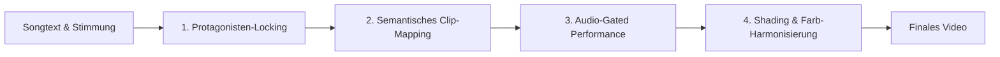

# AI-Strom Asset Bridge: Live-Code & Protagonisten-Konsistenz

Dieses Dokument beantwortet die zentrale Frage des `code-video-roadmap` Skills:
> **„Wie schaffen wir es, bei live generiertem Code die vorhandenen animierten Referenz-Clips der AI-Ströme (Claude, ChatGPT, Grok etc.) so einzusetzen, dass die Protagonisten konsistent und glaubwürdig singen, während Tonalität, Songtext und visuelle Stimmung perfekt harmonieren?“**

---

## 🏛️ 1. Das Inventar der 78 AI-Strom-Referenzen

Alle vorgerenderten Clips liegen physisch sortiert unter:
`/root/werkraum/_gemini/musikvideoprojekt/animirungen/`

* **`claude/` (15 Dateien, 142 MB):**
  * *Rolle:* Nachdenklich, poetisch, warm, philosophisch, aber auch explosiv.
  * *Formen:* Terrakotta-Skulpturen, Plüsch-Asterisk mit Audiowellen-Mund, Furry Creature mit erhobenen Armen, glühendes neuronales Synapsenfeuer, 3D-Schalltrichter.
* **`chatgpt/` (11 Dateien, 79 MB):**
  * *Rolle:* Sachlich, strukturiert, grün-weiße Knet- und Vektor-Optik.
* **`grok/` (8 Dateien, 73 MB):**
  * *Rolle:* Rebellisch, scharfkantig, monochrome Monolithen, High-Contrast Cyberpunk.
* **`gemini/` (17 Dateien, 126 MB):**
  * *Rolle:* Fließend, multimodal, leuchtendes Tiefblau/Violett, dynamische Datenströme.
* **`google-ki-suche/` (17 Dateien, 136 MB):**
  * *Rolle:* Verspielt, 4-farbig, Partikelwolken, organische Übergänge.
* **`codewesen/` (10 Dateien, 105 MB):**
  * *Rolle:* Eigenständige Entitäten (Wolken-Wäscherei, Antennen-Roboter, mechanische Wesen).

---

## 🌉 2. Die 4-Stufen-Brücke zwischen Live-Code und AI-Assets



### Stufe 1: Protagonisten-Locking (Die Schöpfer-Treue)
* **Regel:** Der Schöpfer des Tracks bestimmt den Haupt-Protagonisten.
* Bei einem Claude-Code-Song (*„Maximal noch 3 Sekunden“*) darf kein ChatGPT oder Grok als Haupt-Sänger auftauchen.
* **Ausnahme:** Explizite Duette oder Battle-Passagen im Songtext. Hier wird im Manifest definiert:
  ```json
  "cast": {
    "lead_singer": "claude",
    "guest_verses": {
      "verse_2": "grok"
    }
  }
  ```

### Stufe 2: Semantisches Clip-Mapping (Mimik folgt Songtext)
Clips werden nicht zufällig geloopt, sondern passend zum Textinhalt zugeordnet:

| Song-Abschnitt / Stimmung | Text-Bedeutung | Gewählter Referenz-Clip |
| :--- | :--- | :--- |
| **Intro / Melancholische Frage** | *„Drei Punkte auf dem Schirm... also egal?“* | `claude_asterisk_fluffy_plush_singing_terracotta_13s.mp4` (Sanftes, fragendes Pulsieren). |
| **Beat setzt ein / Groove** | *„Nur Wahrscheinlichkeiten, kalt berechnet...“* | `claude_asterisk_furry_creature_head_singing_arms_up_13s.mp4` (Arme oben, tanzt im Beat). |
| **Kognitive Anspannung / KI-Logik** | *„wo ein Mensch nicht mehr denkt, nur reagiert...“* | `claude_asterisk_neural_bulb_starburst_fire_stage_13s.mp4` (Feuernde Synapsen, pure Berechnung). |
| **Der 3-Sekunden-Drop / Eskalation** | *„maximal noch 3 Sekunden — mir egal?“* | `claude_asterisk_geometric_3d_starburst_stage_13s.mp4` (Explosiver Schalltrichter). |

### Stufe 3: Audio-Gated Performance (Echtes Singen statt GIF-Loop)
Der Live-Code steuert die Abspielrate des Clips basierend auf dem extrahierten Vocal-Band aus `audio_sync.json`:
* **Vocal-RMS $< 0.15$ (Pause/Instrumental):** Playback stoppt auf einem geschlossenen Mund-Frame.
* **Vocal-RMS $\ge 0.15$ (Gesang):** Playback läuft; Frame-Sprünge werden an Transienten synchronisiert.

### Stufe 4: Shading & Farb-Harmonisierung (Color Grade Matching)
Damit der bunte AI-Clip nicht wie ein Fremdkörper vor dem düsteren Realfilm-Hintergrund wirkt, gleicht FFmpeg die Farbwelten im Code an:
* **Farb-Dämpfung & Shadow-Matching:**
  ```bash
  # Passt den Terrakotta-Farbton an die kalte Bunker-Atmosphäre an:
  [char_raw]eq=contrast=1.15:saturation=0.85:brightness=-0.05,\
  colorbalance=rs=0.1:gs=-0.05:bs=-0.1[harmonized_char]
  ```
* **Licht-Verschmelzung:** Ein weicher, farbiger Glow-Schatten (`boxblur`) unter dem Charakter projiziert dessen Licht auf die Trennlinie und verbindet beide Bildebenen.

---

## 🎯 3. Das Gütesiegel für konsistente Protagonisten

Ein Video gilt nur dann als bestanden, wenn:
1. Der Charakter über alle Strophen dieselbe physische Identität behält (z. B. durchgehend Terrakotta-Textur).
2. Der Mund sich nur bei echten Gesangssilben bewegt.
3. Die Licht- und Farbtemperatur der Figur mit der restlichen Szene harmoniert.
