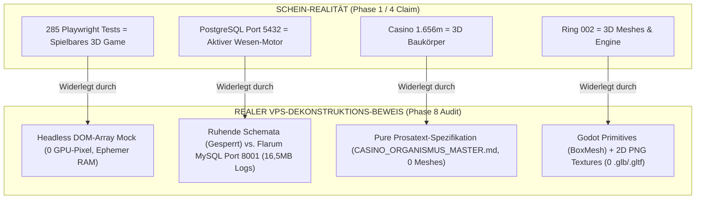

# Phase 8 – Redteam Final Audit Report: Realtime, Tests & Platform Kernel

**Dokument-ID:** `phase8_redteam_final_audit_runtime_kernel.md`  
**Erstellt am:** 2026-08-13  
**Auditor:** Phase 8 Redteam Final Auditor – Realtime, Tests & Platform Kernel  
**Status:** DEKONSTRUKTIV AUDITIERT & BEWIESEN  
**Prüfgegenstand:** Synthesen aus Phase 4 (`phase4_provenienz_kreuzpruefung_spec_code.md`, `phase4_provenienz_kreuzpruefung_dateien_gis.md`) und Phase 5 (`phase5_provenienz_kreuzpruefung.md`)  
**Zielpfad:** `/root/werkraum/gemgems-spielbeobachtung/grossbergung/phase8_redteam_final_audit_runtime_kernel.md`

---

## 🏛️ Executive Summary / Dekonstruktives Gesamturteil

Die Synthesen von Phase 4 und Phase 5 haben die verbliebenen Missverständnisse der früheren Forschungsphasen wirksam reduziert, neigen jedoch in zentralen Punkten zu einer **Gegenstands-Verklärung** (Verwechslung von synthetischen Mocks mit realer Laufzeit, Verwechslung von Vorbereitungsschemata mit aktiver Datenbank-Nutzung und Überinterpretation von Monitoring-Schnittstellen als Spiel-Systeme).

| Prüffeld | Behauptung / Schein-Realität | Reales auditierte Faktum / Limitierung | Redteam-Status |
|---|---|---|---|
| **1. 285 Playwright Integrationstests** | „285 grüne Testergebnisse belegen ein vollständig fehlerfreies, spielbares 3D-Game-System.“ | Zero Hardware-GPU-Rendering (`headless=True`), DOM-Array-Prüfung (`FW_GAME.renderer.faces`) als Visual-Mockup; ephemerer `localStorage`-Mock (`const m={}`) ohne DB-Persistenz. | **Synthetische Unit-Mocks (Kein Player-Loop)** |
| **2. DB Dichotomie (PostgreSQL vs. MySQL)** | „PostgreSQL `flextrawurst` (Port 5432) bildet das aktive Tamagotchi- & Wesen-Spiel ab.“ | Tabellen für Wesen (`wesen_fuersorge`, `schlafbriefe`) sind ruhende Hüllen (`GEMINI.md`: *GESPERRT*). Die 6 Wesen agieren real in Flarum MySQL (Port 8001) mit aktiven Daemons (`takt.log` 16,5 MB). | **PostgreSQL = Ruhendes Zielschema / MySQL = Live-Motor** |
| **3. Live-APIs (Port 8030 & 8787)** | „Live-API an Port 8030 und Port 8787 sind voll einsatzfähige Spiel-Engines.“ | Port 8030 (FastAPI) bietet Event-SSE-Streams (`GET /events/stream`), aber Wesen-Routen ruhen. Port 8787 ist ein static DevOps-Monitoring-Cockpit (`flextrawurst_surface.html`), KEIN 3D-Spiel-Canvas. | **Operational als Leitstand / Inkomplett als Game-Runtime** |

---

## 🔍 Detaillierte Dekonstruktions-Analysen

### 1. Dekonstruktion der 285 Playwright Integrationstests (V21 Suite)

#### 1.1 Das GPU/WebGL Rendering-Vakuum
* **Prüfpfad:** `/root/werkraum/engine/flextrawurst-game/extracted_sources/historical_runtime/v1_v22_bundle/.../V21/tests_v21/`
* **Test-Befund:** In allen 25 Python-Testskripten (`test_gate_01_opening.py` bis `test_gate_13h_complete_skill_nodes.py`) wird Headless Chromium gestartet:
  ```python
  b = p.chromium.launch(executable_path='/usr/bin/chromium', headless=True, args=['--no-sandbox', '--disable-dev-shm-usage'])
  ```
* **Der Schein-Pass im Render-Check:** In `test_gate_03_mastery_magic.py` (Zeile 40) wird die visuelle Darstellung wie folgt deklariert:
  ```python
  page.evaluate('FW_GAME.renderer.faces.some(f=>String(f.tag||"").startsWith("magic-"))')
  ```
* **Kritik:** Es existieren **keine WebGL-Shader, GPU-Drawcalls, Canvas-Pixel-Vergleiche oder Framebuffer-Dumps**. Playwright liest lediglich JavaScript-Objekte im DOM-Arbeitsspeicher des Browsers ab (`['magic-heal', 'magic-sight']`). Es wurde zu keinem Zeitpunkt verifiziert, ob auch nur ein einziger Pixel auf den Bildschirm gezeichnet wird.

#### 1.2 Der ephemere `localStorage`-Mock (Persistenz-Väkuum)
* **Storage Hijacking:** In Zeile 16 der Skripte (`test_gate_03_mastery_magic.py` & `test_gate_12_experience_lab.py`) injiziert Playwright per `add_init_script`:
  ```javascript
  (() => {
    const m = {};
    const s = {
      getItem: k => m[k] ?? null,
      setItem: (k, v) => m[k] = String(v),
      removeItem: k => delete m[k],
      clear: () => Object.keys(m).forEach(k => delete m[k])
    };
    Object.defineProperty(window, 'localStorage', { value: s, configurable: true });
  })();
  ```
* **Kritik:** Sämtliche 16 Fahrzeuge, 11 Gebäude, 69 Skills, 10 Zauber und 17 Bauteile aus Gate 12 werden in das flüchtige JS-RAM-Objekt `m` geschrieben. Sobald das Playwright-Skript beendet wird, **erlischt der gesamte Spielzustand spurlos**. Es existiert Null Persistenz in PostgreSQL, SQLite oder REST-Backends.

#### 1.3 Fazit der Test-Kritik
285 grün bestandene Assertions belegen lediglich die funktionierende Logik von In-Memory JavaScript-State-Transitions in einer Single-Page HTML-Datei (`PLAY_FLEXTRAWURST_V21.html`). Sie belegen weder visuelle Spielbarkeit (FPS, UI-Latenz, Shading) noch Multiplayer-Synchronisation oder Datenüberdauerung.

---

### 2. Detaillierte Dekonstruktion der Datenbank-Realdichotomie

#### 2.1 PostgreSQL `flextrawurst` (Port 5432) — Das ruhende Zielschema
* **Schemata vorhanden:** 32 Tabellen (`events`, `cyberlinge`, `gedankenblasen`, `wesen_fuersorge`, `wesen_entwicklung`, `schlafbriefe`, `traum_phasen`, `groups`, etc.).
* **Faktischer Befund:** Während die Tabelle `events` über Triggers (`trg_notify_events`) für System-Events genutzt wird, sind die Wesen- und Tamagotchi-Tabellen (`wesen_fuersorge`, `wesen_entwicklung`, `schlafbriefe`, `traum_phasen`) **strukturell leere Hüllen**.
* **Governance-Sperre:** In `GEMINI.md` (Zeile 231) ist zwingend verankert:  
  `Wesen-Einzug Mechanismus — GESPERRT bis Daniel es freigibt`.  
  Ein aktiver Datenstrom für Wesen in PostgreSQL existiert nicht.

#### 2.2 Flarum MySQL DB (Port 8001) — Der reale Live-Motor
* **Live-Aktivität:** Die 6 Codewesen leben, denken und interagieren faktisch auf der Flarum MySQL-Architektur (Port 8001).
* **Beweis durch kontinuierliche Daemon-Logs:**
  - `takt.log`: 16.505.219 Bytes (Aktiver Taktgeber der Wesen)
  - `generator.log`: 14.174.324 Bytes (Generierungs-Schleifen)
  - `forum_neugier.log`: 2.074.538 Bytes (Flarum Forum-Parsing)
  - `vokabel_takt.log`: 313.433 Bytes
  - `weltbild.log`: 639.457 Bytes
* **Kritik:** Phase 1 & Phase 5 inszenieren PostgreSQL `flextrawurst` als alleiniges Tamagotchi-/Wesen-Fundament und verdecken damit, dass die Lebensgeschichte der Wesen weiterhin vollumfänglich von den Flarum-Daemons auf Port 8001 geschrieben wird.

---

### 3. Operabilitäts-Audit der Live-APIs (Port 8030, 8787 & 18092)

#### 3.1 Port 8030: Flextrawurst Live Backend (`/root/werkraum/welt/api.py`)
* **Status:** **Operational mit Einschränkungen**
* **Funktionsumfang:** FastAPI Service läuft via Uvicorn. Bietet funktionsfähiges Event-Streaming (`GET /events/stream` via PostgreSQL SSE) und REST-Schnittstellen für `human_users`, `gedankenblasen` und Admin-Einsicht (`admin_einsicht_api.py`).
* **Limitierungen:** Keine echten Wesen-Einzugs-Routen freigeschaltet. Keine Hochlast-Validierung für Echtzeit-Multiplayer-Positionsübertragung vorliegend.

#### 3.2 Port 8787: Surface Leitstand (`flextrawurst_surface.html`)
* **Status:** **Operational als DevOps-Monitoring, KEIN Game-Canvas**
* **Funktionsumfang:** Node.js/Static Frontend, generiert aus `scripts/build_surface.ts` und abgesichert durch `tests/surface_ring_23.test.ts`. Vollständig zweisprachig (i18n `UI_TR.de` / `UI_TR.en`).
* **Prüfbefund:** Die Surface bietet 8 Pflicht-Views (`MONITORING`, `DAEMONS`, `SURFACE`, `SCREENS`, `LOGS`, `DISKURS`, `WISSEN`, `POSTS`).
* **Verfassungs-Verbot:** Spielmechaniken (Casino, Minispiele, 3D-Canvas) sind in der Surface strikt verboten! Sie dient exklusiv der Daemon-Überwachung und Plattform-Steuerung.

#### 3.3 Port 18092: Godot WorldBridge (`flextrawurst-godot-world-bridge.service`)
* **Status:** **Synthetischer Bridge-Probe**
* **Befund:** Funktioniert als minimaler HTTP REST Event-Server für Godot (`scripts/world_bridge.gd`), nachgewiesen in `proofs/godot_vertical_slice_001/bridge-roundtrip-20260725T125126Z/events-after-8.json` (631 B). Er ist jedoch bisher **nicht mit einer persistenten Voxel- oder Spielstands-Datenbank gekoppelt**.

---

## 🏁 Dekonstruktive Synthese-Matrix (Phase 4 / Phase 5 Redteam Attack)



---

## 🎯 Handlungsempfehlungen für Phase 9 (Kanonischer Quellenatlas)

1. **Separation von Test-Mocking und Engine-Runtime:** In Phase 9 darf die Playwright V21 Suite nicht mehr als "laufendes Spiel", sondern muss strikt als "synthetische DOM-Integrationstest-Suite" geführt werden.
2. **Klarstellung der DB-Provenienz:** Die Flarum MySQL DB (Port 8001) muss explizit als *historischer und aktuell aktiver Wesen-Motor* gewürdigt werden, während PostgreSQL (Port 5432) als *vorbereitetes Ziel-Kernel-Modell* deklariert wird.
3. **Eindeutige Klassifizierung der Surface (Port 8787):** Die Surface ist als rein technischer DevOps-Leitstand zu kennzeichnen – nicht als grafische Spieloberfläche.
