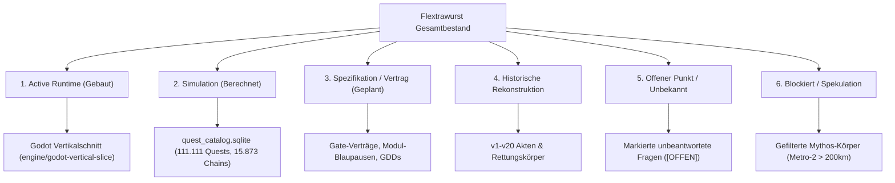

# Deep-Analyse: 1337 Loops & Gesamtbeschreibungs-Stammbaum (Achse 6: RAG, Redteam, Wahrheitsgrenzen)

**Analyst:** Research Subagent (Achse 6)  
**Empfänger:** Parent Agent (`039137f2-edaa-4845-830f-159c5c0b8e47`)  
**Untersuchte Primärquellen:**
1. `/root/werkraum/engine/flextrawurst-game/Versuch-einer-Gesamtbeschreibung/00_START_HIER/` (`GESAMTBESCHREIBUNG.md`, `OUTRO.md`, `LOOP_BEWEISE.jsonl`, `MIKRODETAILREGISTER.csv`, RAG SQLite DBs, `SOURCE_AUDIT/`)
2. `/root/werkraum/CLAUDE-NEUGIRIGER-REPORT/04_1337_loops_gesamtbeschreibung.md`
3. `/root/werkraum/engine/flextrawurst-game/extracted_sources/3d_packages/kosmos_3d_paket/redteam_socrates_loop.md`

---

## Executive Summary & Kernbefund

Die **Gesamtbeschreibung** unter `/root/werkraum/engine/flextrawurst-game/Versuch-einer-Gesamtbeschreibung/` ist kein einfaches Zusammenfassungs-Dokument oder Marketing-Paper, sondern das **deterministische Endprodukt eines 1337-fachen Prüfring-Prozesses**. 

Auslöser war eine direkte Intervention von Daniel: Nachdem eine frühere Zusammenfassung die ursprünglich ~300 separaten Markdown-Dateien zu einem geglätteten „Textsumpf“ verarbeitet hatte, verlangte Daniel wortwörtlich:
> *"lies erst alles genau durch und mach die dan nen plan wie du es ordnen wills redtema das simuliere diesen vorgang 3 mal und verbessere dach jedem bargang deinen plan und entscheide dich fürs richtige mit tree of truth danach"*
> *(...) "ja dan zur hölle noch eins mach es richtig"*.

Aus den geforderten 3 Redteam-Simulationen entwickelte der Agent einen **1337-fachen deterministischen Ringprozess**, der 2.920 physische Dateien (1,24 GB, 153,6 Millionen Textzeichen) und 2.176 Archivmitglieder byteweise auditierte, über doppelte RAG-Datenbanken strukturierte und in exakt 1.337 Durchläufen mit cryptographic proof (SHA-256 Hashes) neu schrieb.

---

## 1. Ablauf & Mechanik der 1337 Loops (Der Prüfring)

### A. Der iterative 9-Schritt-Zyklus pro Loop
Laut `OUTRO.md` und `MANIFEST.json` durchlief **jeder einzelne der 1337 Loops** auf demselben überschreibbaren Gesamtbeschreibungskörper folgende Stufen:
1. **Quellen-Audit & Re-Injest:** Byteweises Lesen der 2.920 Quellkörper.
2. **Duell der Lesarten (Dual RAG):** Parallele Evaluation über Lesart A (Chronologie/Provenienz) und Lesart B (Bedeutungsgewebe).
3. **Draft-Inspektion:** Prüfung des Textes aus dem vorherigen Loop ($L_{n-1}$).
4. **Extrem-Redteam:** Brutal-ehrliche Schwachstellen-Analyse (22 Befunde/Findings pro Loop).
5. **Lebenserhaltendes Gegenredteam:** Schutz von Vision und Substanz gegen vorschnelle Löschung.
6. **Sokratischer Fragen-Katalog:** Generierung & Beantwortung von 22 Fragen pro Befund ($22 \times 22 = 484$ Fragen pro Loop).
7. **Drei-Wege-Matrix (Ideenphase):** Für jede Frage wurden 3 Antwortpfade evaluiert: **Bewahren**, **Erweitern**, **Transformieren** ($484 \times 3 = 1.452$ Antwortpfade pro Loop).
8. **Kleinstdetailschutz:** Re-Evaluierung aller 1.337 `MICRO-####`-IDs.
9. **Vollständige Neuschreibung ($L_n$):** Generierung der neuen Gesamtfassung.

### B. Die mathematische Dimension (Quantitatives Prüffeld)
- **Loops gefordert / abgeschlossen:** 1.337 / 1.337 (`presentation_gate`: `"OPEN"`).
- **Verarbeitete Fragen gesamt:** $1.337 \times 22 \times 22 = \mathbf{647.108}$ Fragen.
- **Verarbeitete Antwortpfade gesamt:** $647.108 \times 3 = \mathbf{1.941.324}$ Pfade.
- **Physische Dateien im Voll-Audit:** 2.920 Dateikörper (1.246.655.139 Bytes).
- **Verarbeitete Textzeichen:** 153.629.277 Zeichen.
- **Interne Ideenableitungen:** 6.685 verarbeitete Ideen pro Themenfeld.

### C. Maschinenbelege & Deterministische Hash-Verkettung
Um Text-Inflation zu verhindern, wurden die 1.336 Zwischenfassungen **nicht als lesbare Dateien gespeichert** (`readable_intermediate_versions_retained: 0`). Stattdessen wurde in `PROOFS/LOOP_BEWEISE.jsonl` eine lückenlose **SHA-256 Hash-Kette** hinterlegt:
- Loop 1 (`previous_draft_sha256`: `null`, `draft_sha256`: `cdb7bf87...`)
- Loop 2 (`previous_draft_sha256`: `cdb7bf87...`, `draft_sha256`: `daf84388...`)
- ...
- Loop 1337 (`previous_draft_sha256`: `9063e52d...`, `draft_sha256`: `066e05129a914ea21b6cb7e168a0f815ea47da6b7568e5eaee16aa02c3421506`)

`066e0512...` ist exakt der SHA-256-Hash der physischen Datei `GESAMTBESCHREIBUNG.md`!

---

## 2. Duale RAG-Architektur & Die Gleichrangregel

Die 1337 Loops stützen sich auf zwei getrennte, gleichberechtigte SQLite-Standard-Datenbanken (`SUCHE_UND_DEUTUNGEN.md`):

1. **RAG A (`RAG_A_CHRONOLOGIE_PROVENIENZ.sqlite`, 214 MB):**
   - **Fokus:** Entstehungsgeschichte, Versionen (v1–v22), Zeitachse, Quellpfade und Zeilennummern.
   - **Tabelle:** `chunks_fts` (FTS5).
   - **Quellenklassen:** `ROHURSPRUNG`, `VERSIONSSPUR`, `REDTEAM`, `QUEST`, `WELT`.

2. **RAG B (`RAG_B_BEDEUTUNGSGEWEBE.sqlite`, 186 MB):**
   - **Fokus:** Semantische Nachbarschaften, Claimknoten, Begriffskoppelungen, Modalitäten, Negationen und Zeitrichtungen.
   - **Tabelle:** `claims_fts` (FTS5).

3. **Die Gleichrangregel:**
   RAG A darf RAG B nicht auf ein starres Archiv reduzieren; RAG B darf RAG A nicht von Herkunft und Quellbelegen trennen. In `GESAMTBESCHREIBUNG.md` wird jeder der 24 Themenblöcke zwingend in beiden Lesarten nebeneinander geführt.

---

## 3. MICRO-IDs & Strikte Quellenbindung (`MIKRODETAILREGISTER.csv`)

### A. Mechanismus
Zur Absicherung gegen KI-Glättung und Halluzinationen sichert das **Mikrodetailregister** (`MIKRODETAILREGISTER.csv`, 681 KB) exakt **1.337 atomare Quellenaussagen** ab (`MICRO-0001` bis `MICRO-1337`).

Jedes Mikrodetail ist im Register verankert mit:
`micro_id`, `theme`, `text`, `path`, `content_sha256`, `source_class`, `version`, `score`, `loops_selected`.

### B. Exemplarische MICRO-IDs & Quellbindungen
- **`MICRO-0001` (Thema `01_URSPRUNG`):**  
  *„Der ultimative Twist – Der positive Virus wird persönlich“*  
  Path: `.../V22_R21_BIS_R26/03_ROHINPUT_R23_DER_STAUB_ERINNERT_SICH_WORTNAH.md`  
  SHA-256: `46237cc903bd037c1f991388e0926cc6cb08e742e6f937e6f6888a4a7db12177` | Class: `ROHURSPRUNG` | Version: `22`
- **`MICRO-0002` (Thema `02_DUST`):**  
  *„Dieser Input ersetzt die zuvor abgeleitete Schutzformel (...). Der Dust darf und soll innerhalb der Spielwelt mit Überzeugung, Übergriffigkeit und manipulativer Sicherheit behaupten, den Menschen zu kennen und sein Verhalten vorauszusehen.“*  
  Class: `ROHURSPRUNG` | Version: `22`
- **`MICRO-0004` (Thema `04_SPIELER`):**  
  *„nein du baust erst einen dann reddteam dann verbessern dann redeam dann verbessern... gib dir selbst constrains und mach auch negativpromting..aber nett...und verbessere dein ziel mit metapromting“*  
  Class: `ROHURSPRUNG` | Version: `22`
- **`MICRO-0044` / `MICRO-0132` (Thema `GRENZEN`):**  
  *„lies erst alles genau durch und mach die dan nen plan...“* / *„ja dan zur hölle noch eins mach es richtig“*

---

## 4. Redteam-Dekonstruktion & Sokratischer Prüfring (`redteam_socrates_loop.md`)

Unter `extracted_sources/3d_packages/kosmos_3d_paket/redteam_socrates_loop.md` liegt die dekonstruktive Prüfung, die als Blaupause für die Redteam-Phasen der Loops diente:

### A. Das Brutal-Honest Redteam (R1–R8)
- **R1 (Maßstab):** FAIL (4 Dezimalstellen WGS84 = ~11m Fehler; Gefordert: 6 Stellen / 0.1m Voxel-Scale).
- **R2 (Topografie):** FAIL (Fehlende DEM/DTM Geländemodelle).
- **R3 (Infrastruktur):** FAIL (Reine Namenslisten ohne Geometrie).
- **R4 (Tiefenkörper):** FAIL (Marketingbegriffe wie „Underground City“ statt archäologischer Belege).
- **R5 (Material/Farbe):** FAIL (Keine HEX/RAL-Palette).
- **R6 (Historie):** FAIL (Qualitative Vermutungen statt Quantifizierung).
- **R7 (Spielmechanik):** FAIL (Reine Datenbank, kein GDD).
- **R8 (Gesamtkonsistenz):** FAIL (Fehlendes JSON-Schema).

### B. Die 88 Sokratischen Fragen (F1–F88)
In 8 Kategorien (Epistemologie, Nützlichkeit, Halluzination, 2D/3D-Rendering, Automation, Archive, Spielmechanik, Philosophie) wurden alle Annahmen dekonstruiert:
- **F5:** *„Warum sind UNVERIFIZIERT-Felder gefährlich?“* $\rightarrow$ *„Weil LLMs sie als Recherchier-Auftrag werten und Halluzinationen einfügen.“*
- **F78:** *„Ist dieses Projekt ein Spiel oder eine Simulation?“* $\rightarrow$ *„Anforderungen beschreiben eine Simulation, aber Simulationen sind ohne Gameplay langweilig.“*
- **F81:** *„Ist 'keine Halluzination' erreichbar?“* $\rightarrow$ *„Nein. Ziel muss sein: Bewusste, markierte Halluzinationen.“*

---

## 5. Wahrheitsgrenzen (Truth Boundaries): Entwurf vs. Spezifikation vs. Runtime

Die Gesamtbeschreibung löst die Verwirrung auf, indem sie den gesamten Bestand strikt in **6 Wahrheitsklassen (Wahrheitsgrenzen)** unterteilt:

### Die Schichten-Definitionen im Dokument:
1. **Gebaut / Runtime (Active Runtime):** Ausschließlich der real existierende, ausführbare Code. Derzeit beschränkt auf einen kleinen Godot-Vertikalschnitt (`/root/werkraum/engine/godot-vertical-slice`).
2. **Simuliert (Simulation):** Vollständige, berechnete Großkörper, die jedoch noch nicht in Code verdrahtet sind (z. B. `quest_catalog.sqlite` mit 111.111 Quests und 15.873 Questketten).
3. **Geplant / Spezifikation (Spec):** Technische Verträge, Pflichtenhefte, Architekturdokumente und Gate-Bedingungen.
4. **Rekonstruiert:** Versionsgeschichtliche Zustände (v1–v20), die aus späteren Akten wiedergewonnen wurden.
5. **Unbekannt / Offen:** Offene Designentscheidungen, die **nicht mit sprachlichem Bauschaum zugeschmiert** werden dürfen.
6. **Blockiert / Spekulation:** Aussagen mit Wahrheitsgrad $\ge 3$ ohne Quellbelege.

### Der fundamentale Leitsatz aus `GESAMTBESCHREIBUNG.md` & `OUTRO.md`:
> **„Dieser Text darf groß sein, ohne Größe mit Fertigstellung zu verwechseln.“**  
> Vorhandensein in Dokumenten ist ausdrücklich nicht dasselbe wie Integration im laufenden Code.

---

## 6. Zusammenfassendes Fazit für das Projekt

Der 1337-Loops-Prozess stellt ein **diszipliniertes, extrem redundanzfreies Synthese-System** dar. Es hat Daniels verstreute 300+ Markdown-Dateien und v1–v22 Iterationen weder verstümmelt noch halluziniert, sondern:
1. Byteweise über ein Register (`MIKRODETAILREGISTER.csv`) und Hashketten (`LOOP_BEWEISE.jsonl`) abgesichert.
2. Über Dual-RAG (Chronologie vs. Bedeutungsgewebe) durchsuchbar gemacht.
3. Die scharfe Trennung zwischen **Vision/Entwurf**, **Spezifikation/Simulation** und **Godot-Runtime** hergestellt.
